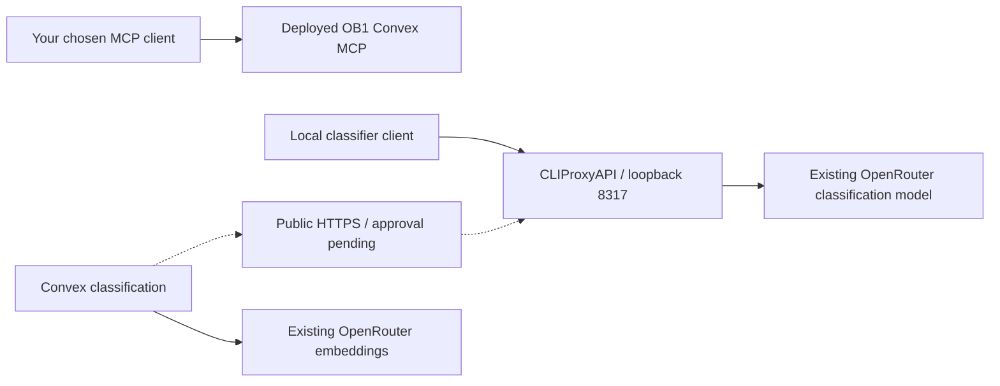

# Standalone OB1 and CLIProxyAPI



Standalone installation does not register OB1 with T3. The private MCP bundle and
runtime-neutral skill can be imported into a client you explicitly choose later.
Thoughts and Agent Memory remain separate; generated memory stays pending human
review. Workspace/project IDs are caller context, not tenant authentication.

Nate B. Jones / OB1 provides practical systems like this:
[Substack](https://substack.com/@natesnewsletter),
[natebjones.com](https://natebjones.com).

## Prerequisites

- macOS, Node.js 24+, Ruby, and an existing CLIProxyAPI local binary/profile.
- Configured integration `.env.local` with development Convex site, distinct
  agent/admin keys, and an existing OpenRouter key.
- Local proxy profile bound to `127.0.0.1:8317`, management/control panel disabled.
- User-home and proxy-profile installation writes permitted.

## Installation

1. Inspect the preflight from the integration directory:

   ```bash
   cd /Users/mt/src/OpenBrain1/integrations/convex-open-brain
   node scripts/setup-standalone.ts --check
   ```

2. Run the installer once:

   ```bash
   node scripts/setup-standalone.ts
   ```

   It refuses existing destinations or conflicting provider/client entries. It
   preserves unrelated proxy settings and client keys, backs up the original
   proxy config to `bin/local/config.yaml.ob1-backup`, adds the v8
   `api-keys.openai-compatibility` group `ob1-openrouter`, and advertises alias
   `ob1-classifier` for the existing classification model. No OAuth account is
   imported; the existing paid OpenRouter account supplies upstream requests.

   The installer disconnects an existing shared Codex `ob1-brain` entry only when
   its URL matches this deployment, and removes a global memory skill link only
   when it points to this repository's canonical skill. Other entries and skills
   stay intact. It adds no T3 settings, provider, tools or host hooks.

3. Verify the installed proxy:

   ```bash
   node smoke/proxy-smoke.ts
   ```

   Expected outcome: authenticated alias listing and real JSON classification
   pass; missing/invalid keys return `401`; management routes return `404`.
   This performs one harmless paid model request. It writes no memory.

## Installed files and service

| Path / service | Purpose |
| --- | --- |
| `~/.config/ob1/mcp.json` | Generic MCP URL and agent-only header; mode `0600`. |
| `~/.config/ob1/standalone.env` | Local proxy URL, dedicated client key and model alias; mode `0600`. |
| `~/.config/ob1/skills/ob1-agent-memory` | Isolated skill copy; not in global client discovery. |
| `~/.config/ob1/logs` | Local process logs; private directory/files. |
| `~/Library/LaunchAgents/com.ob1.cliproxyapi.plist` | Start at user login and restart on exit. |
| `com.ob1.cliproxyapi` | CLIProxyAPI service using the existing binary and local profile. |

The service requires this Mac and user session to be running. A future unattended
server installation should use its own host and credentials rather than assuming
a sleeping laptop is available. The standalone skill is copied from this repo;
updates require recopying it.

Import the private `mcp.json` only into a client you choose. Runtime-specific
configuration formats may differ. Never share its contents or install the admin
key in an agent. Resolve actual workspace/project IDs before using Agent Memory.
Human confirmation is a product workflow; installation does not confirm memory.

## Hosted Convex classification

Local service installation is verified. Hosted Convex cannot reach laptop
loopback. Its classification continues using existing OpenRouter settings until
an authenticated HTTPS endpoint is explicitly published and verified.

The proposed endpoint uses this machine's MagicDNS HTTPS name:
`https://YOUR_MACHINE.YOUR_TAILNET.ts.net/v1`, forwarding only to the private
loopback proxy. Public exposure was authorized by the user's continuation on
2026-10-10. The publication command passed approval review, then Tailscale reported
`Funnel is not enabled on your tailnet.` Its activation page requires admin sign-in.
No Funnel endpoint is active yet; hosted classification settings remain unchanged.

1. Enable Funnel through the node-specific activation URL printed by this command:

   ```bash
   /Applications/Tailscale.app/Contents/MacOS/Tailscale funnel --bg --https=443 http://127.0.0.1:8317
   ```

   Use the full executable path; this machine's `tailscale` symlink fails bundle
   identification. Sign in on the activation page and enable Funnel for the node.
   Keep unrelated forwarding intact. Background mode retains the forwarding
   configuration across Tailscale restarts.

2. Verify public authentication, disabled management, and actual classification:

   ```bash
   cd /Users/mt/src/OpenBrain1/integrations/convex-open-brain
   OB1_PROXY_HTTPS_URL=https://YOUR_MACHINE.YOUR_TAILNET.ts.net/v1 pnpm smoke:proxy
   ```

3. Only after HTTPS verification passes, record the prior classification settings
   privately and set the development deployment's separate base/key/model using
   the installed dedicated proxy key and `ob1-classifier` alias. Verify captured
   thought metadata contains explicit people from the model response; a successful
   capture alone can hide classification fallback. Delete only that test thought.

Follow
[classification setup](t3-ob1-setup.md#classification-through-cliproxyapi) for the
environment contract. Embedding provider/model remain unchanged.

## Continuation checkpoint — 2026-10-10

- Reverified `dev:grandiose-deer-590`, private standalone credentials, connected
  Tailscale device, and empty forwarding configuration.
- Prior public-exposure approval blocker resolved by user continuation; new
  blocker is Tailscale admin activation/sign-in, not another approval rejection.
- Publication command printed a node-specific activation URL; integrated browser
  opened that URL and reached the Tailscale sign-in screen.
- Independent classifier base/key remain unset; hosted classifier still uses
  `openai/gpt-4o-mini`. Existing embedding configuration remains present.
- No T3 settings or global skill registration added. Public HTTPS and hosted
  proxy-backed capture are not yet verified.

## Verification checkpoint — 2026-10-09

- Development MCP backend previously deployed and verified: nine tools and
  70 tests passed; [earlier checkpoint](t3-ob1-checkpoint-2026-10-09.md).
- Standalone installer preflight, TypeScript check and script syntax passed.
- Local service installed and running; proxy smoke passed real upstream JSON.
- Shared Codex `ob1-brain` entry absent; global memory skill link absent; isolated
  skill present. Private MCP bundle contains the agent key and no admin key.
- Initial smoke failed because the installer put the upstream group in the wrong
  YAML section. Corrected installer and installed config to v8 `api-keys`; live
  smoke passed. Original profile backup and credentials preserved.
- Read-only focused review found no concrete blocker.
- Public exposure blocked by automatic review; no workaround attempted. Hosted
  classification settings and production deployment unchanged.
- Linear `NAT-833` remains inaccessible to the configured account. Architecture,
  installation and verification are retained here instead of claiming an update.

## Troubleshooting and rollback

- Existing destination: preserve it; inspect current service/config instead of
  rerunning a first-install script over it.
- Alias missing: inspect v8 `api-keys.openai-compatibility`, then rerun smoke.
- Upstream failure: verify OpenRouter key/model locally without sharing logs that
  contain credentials. Smoke checks actual response rather than accepting local
  fallback as provider success.
- Service stopped: inspect `launchctl print gui/$(id -u)/com.ob1.cliproxyapi`.
- Stop/remove service:

  ```bash
  launchctl bootout gui/$(id -u) ~/Library/LaunchAgents/com.ob1.cliproxyapi.plist
  ```

  Remove its plist only after stopping it. Restore `config.yaml.ob1-backup` only
  after checking for subsequent user edits. Keep private bundles until you decide
  to remove them. Rollback does not re-register OB1 with T3 or delete backend data.
