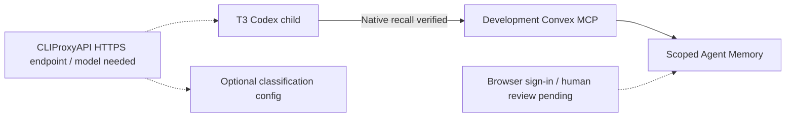

# T3 / OB1 setup checkpoint — 2026-10-09



OB1 Agent Memory stays runtime-neutral. Generated MCP writeback is pending
evidence; human review controls instruction use. Thought capture stays separate.
Nate B. Jones / OB1 provides practical systems like this:
[Substack](https://substack.com/@natesnewsletter),
[natebjones.com](https://natebjones.com).

## Installed and deployed

- Development deployment: `dev:grandiose-deer-590`.
- MCP endpoint: `https://grandiose-deer-590.convex.site/mcp`.
- Deployed three memory tools and additive scoped idempotency index.
- Codex entry installed in `~/.codex/config.toml` as `ob1-brain`.
- Native header helper uses `~/.config/ob1/mcp-headers.json` with mode `0600`;
  agent key verified, admin key absent. Existing config preserved.
- Skill linked at `~/.agents/skills/ob1-agent-memory`.
- Independent classification configuration implemented but unset. Existing
  OpenRouter classification and embeddings remain active. Production untouched.

Follow the [setup guide](t3-ob1-setup.md) for another runtime or deployment.

## Verification

Commands run in `integrations/convex-open-brain`:

```bash
pnpm test
pnpm typecheck
node --check scripts/setup-codex.ts
pnpm exec convex dev --once --typecheck enable --tail-logs disable
node --env-file=.env.local smoke/live-smoke.mjs
node --env-file=.env.local smoke/memory-smoke.mjs
node --env-file=.env.local smoke/memory-mcp-smoke.ts
node scripts/setup-codex.ts
```

- Backend: 70 tests / 7 files passed; typecheck and installer syntax passed.
- Thought smoke: authentication/origin restrictions, SDK protocol, real
  embedding capture/search/fetch; one test thought deleted during cleanup.
- REST smoke: pagination reads and invalid-input/review rejection checks passed.
  Empty review queue meant observable state preservation was not exercised.
- Memory MCP smoke: nine tools, pending writeback, same-scope replay,
  pending exclusion, explicit evidence recall, usage and reconnect passed.
  Only its isolated memory was rejected during cleanup; audit/traces remain.
- Fresh T3-owned child using Codex `gpt-6.1-sol`, high effort, discovered nine
  native tools and the skill. Native `recall_memory` returned `memories: []`
  in the rejected smoke scope; request `2bb3b1bd-70eb-431f-b574-e80a65efc2fd`.
  No SDK substitution, user-memory writes or confirmation.
- Installer duplicate-entry regression: Codex's parser detects valid spaced and
  quoted TOML headers before any config write.
- Skill validator passed with temporary PyYAML dependency. Focused Markdown
  validation passed. No repository dependencies added for these validators.

Initial restricted-network attempts failed DNS resolution; approved retries
succeeded. Initial skill validation lacked PyYAML; temporary dependency fixed it.
Expanded typecheck caught a missing URL assertion; fixed before installation.

## Remaining handoffs

1. Complete Convex dashboard sign-in and T3 settings pairing in browser.
   Last browser status showed authentication screens; subsequent snapshots timed
   out with `Preview automation snapshot timed out after 15000ms.`
2. Provide the intended operational workspace/project IDs. Test scope is not
   product configuration; shared brain key does not provide tenant separation.
3. Identify authenticated, always-available CLIProxyAPI HTTPS endpoint and model.
   Local checkout has no running port `8317` listener or `/embeddings` route.
   Keep existing embeddings; verify an actual classification request before
   applying both independent proxy settings.
4. Human-review a real pending memory, then verify its updated use policy through
   recall in a fresh T3 session. This was not simulated or confirmed by an agent.
5. Restore Linear access to `NAT-833`. Authenticated GraphQL lookup returned
   `Entity not found: Issue` / `INPUT_ERROR`; no issue update was possible.
   This checkpoint retains architecture, implementation and verification log.

The backend/T3 MCP setup is verified. Proxy routing and human confirmation remain
unverified until their handoffs are completed.
