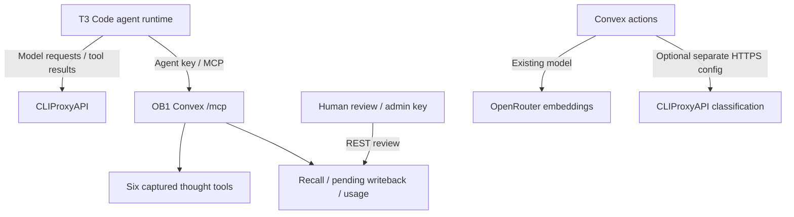

# T3 Code, CLIProxyAPI, and OB1

T3 integration is optional. Current installation uses the
[standalone setup](ob1-standalone-setup.md); its shared Codex connection and global
skill registration were removed at the user's request.



OB1 stays runtime-neutral. The agent calls memory tools; CLIProxyAPI carries model
requests and returned context. Switching a proxy account does not change OB1
storage. Retrieved memory content goes to the selected model through the proxy.
Thoughts and Agent Memory are separate products of the same private backend.

Nate B. Jones / OB1 gives away practical systems like this:
[Substack](https://substack.com/@natesnewsletter),
[natebjones.com](https://natebjones.com).

## Development setup

From the existing integration checkout:

```bash
cd /Users/mt/src/OpenBrain1/integrations/convex-open-brain
pnpm test
pnpm typecheck
pnpm exec convex dev --once --typecheck enable --tail-logs disable
```

Confirm `.env.local` selects the intended development target before pushing.
Existing development target is `dev:grandiose-deer-590`; production is separate.
The deployment builds an additive workspace/project idempotency index. Stored
keys and existing same-scope replays remain compatible; no records are rewritten.

In the integrated browser, open Convex dashboard and select the same development
deployment. Sign-in is a human handoff. T3's web settings may also require a
one-time environment pairing token; enter it in the pairing page, never in chat.

## Codex connection in T3

Select the intended Codex instance in T3 **Settings → Providers** and identify its
`CODEX_HOME`. The default is `~/.codex`. Run the local installer only for that home:

```bash
node scripts/setup-codex.ts
```

The installer preserves unrelated config, refuses to replace an existing
`ob1-brain` entry, credential file, or skill destination, copies only the agent
key to a private `0600` header file under `~/.config/ob1`, and links the
[runtime-neutral skill](../skills/ob1-agent-memory/SKILL.md) into
`~/.agents/skills`. It never installs the admin key. These are user-home writes;
restricted agent execution requires an approved setup command.

The generated native Codex entry uses an HTTP header helper, so desktop/service
launches do not depend on shell exports:

```toml
[mcp_servers.ob1-brain]
url = "https://YOUR_DEPLOYMENT.convex.site/mcp"
http_headers_helper = "/bin/cat '/ABS/PATH/.config/ob1/mcp-headers.json'"
tool_timeout_sec = 60
```

See official [Codex MCP configuration](https://learn.chatgpt.com/docs/extend/mcp?surface=cli)
and [skill discovery](https://learn.chatgpt.com/docs/build-skills).
Restart the affected provider/session and start a fresh T3 thread. Ask it to list
OB1 tools; expect six thought tools plus `recall_memory`, `writeback_memory`, and
`report_memory_usage`. Configure actual workspace/project IDs before using memory;
they select context but do not provide tenant authorization with the shared key.
Invoke `$ob1-agent-memory` for recall/writeback discipline. Skill guidance is not
an automatic T3 host hook.

Other runtimes register the same HTTP MCP URL and agent header through their native
config. Existing OpenCode setup is documented in the
[development checkpoint](mcp-development-status-2026-09-17.md).

## Classification through CLIProxyAPI

The hosted Convex runtime needs an always-available authenticated HTTPS proxy,
not a laptop loopback URL. Verify its advertised model and `/v1/chat/completions`
with a harmless JSON classification request before switching the deployment.

Set **both** independent settings on the chosen development deployment:

```bash
pnpm exec convex env set --deployment dev OPEN_BRAIN_CLASSIFICATION_BASE_URL "https://YOUR_PROXY/v1"
pnpm exec convex env set --deployment dev OPEN_BRAIN_CLASSIFICATION_API_KEY
pnpm exec convex env set --deployment dev OPEN_BRAIN_CLASSIFICATION_MODEL "YOUR_PROXY_MODEL_ID"
```

The key command prompts privately; do not put its value in shell history. URLs
must use HTTPS without credentials, query, or fragment. Both custom settings
unset means existing OpenRouter classification. An incomplete/invalid pair uses
local metadata fallback and sends no request. Provider errors, invalid JSON, and
timeouts retain fallback behavior. A successful capture alone cannot prove proxy
classification ran: inspect provider request status and returned metadata.

`OPENROUTER_BASE`, `OPENROUTER_API_KEY`, and `OPEN_BRAIN_EMBEDDING_MODEL` still supply
embeddings. The inspected CLIProxyAPI checkout has no `/embeddings` route; model
gateway compatibility does not imply embedding support. Keep the existing model.
A different model requires re-embedding both thoughts and Agent Memory, even when
vector dimensions match.

## Verification and cleanup

```bash
node --env-file=.env.local smoke/live-smoke.mjs
node --env-file=.env.local smoke/memory-smoke.mjs
node --env-file=.env.local smoke/memory-mcp-smoke.ts
```

The new memory MCP smoke requires separate agent/admin keys in its isolated test
process. It creates pending generated memory in an isolated smoke scope, checks
idempotency, pending exclusion, explicit evidence recall, usage reporting, and
fresh-connection persistence. Cleanup rejects only the rows it created; records
and audit history remain. It never confirms memory or alters existing records.
Smoke uses paid embedding calls. Do not install its admin credential in T3.

Human confirmation remains the dashboard/REST review workflow with the admin key.
After a person confirms a real memory, a fresh thread should recall its updated
use policy in the same workspace/project. Without browser review and a model
request through the actual proxy, do not claim the full T3/proxy loop is verified.

For rollback, restore previous classification model and remove the two custom
classification settings. Disable `mcp_servers.ob1-brain.enabled` to stop MCP use.
This does not delete stored memory or undo production writes.
