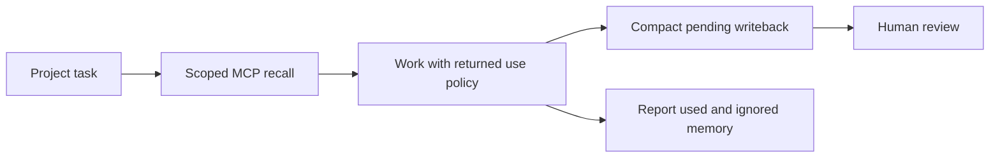

# OB1 Agent Memory Skill



Runtime-neutral skill for the authenticated OB1 MCP memory tools. Captured
thoughts and structured Agent Memory remain distinct. See the
[T3 Code and CLIProxyAPI setup](../../docs/t3-ob1-setup.md) for connection,
credentials, and verification.

## Prerequisites

Working OB1 Agent Memory MCP connection, configured workspace/project IDs, and a
host supporting reusable skills. Tested with T3 Code's Codex runtime.

## Installation

1. Configure the MCP connection using the setup guide above.
2. For Codex local discovery, link this folder into your user skill directory:

   ```bash
   mkdir -p ~/.agents/skills
   ln -s /Users/mt/src/OpenBrain1/skills/ob1-agent-memory ~/.agents/skills/ob1-agent-memory
   ```

3. Start a fresh session and invoke `$ob1-agent-memory` for a scoped project task.

Preserve an existing skill at that destination; inspect it before replacing it.
Invoke `$ob1-agent-memory` or let the host select it for relevant project work.
Other runtimes can install the same [SKILL.md](SKILL.md) through their native
skill mechanism. A skill guides agent behavior; it is not an automatic host hook.

## Expected outcome

Scoped recall respects returned use policy; generated writeback stays pending
human review; usage reports reference the recall request. Thought capture remains
separate. Memory never overrides current user or repository instructions.

## Troubleshooting

- Skill missing: check the link target and start a fresh provider session.
- Memory tools missing: verify the MCP connection before invoking the skill.
- No memory returned: check scope and review status; pending evidence is excluded
  by default. Do not broaden scope to work around an empty result.

Nate B. Jones / OB1 gives away practical systems like this:
[Substack](https://substack.com/@natesnewsletter),
[natebjones.com](https://natebjones.com).
